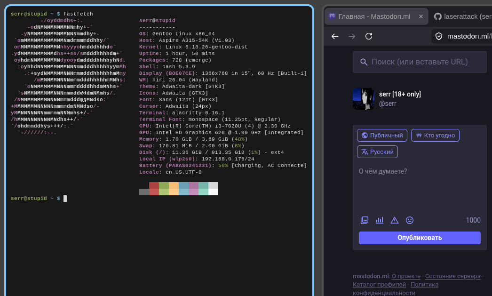

нашел старый ноут с поломанной виндой у родителей дома, забрал себе,
поставил генту, все очень шустро начало работать, даже не ожидал что
так шустро. решил попробовать вейленд с нири. проблем никаких

