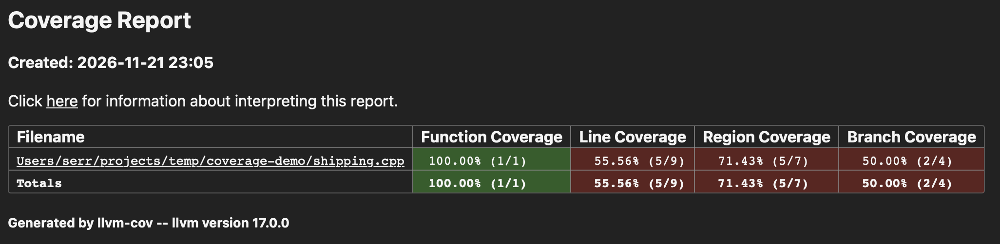
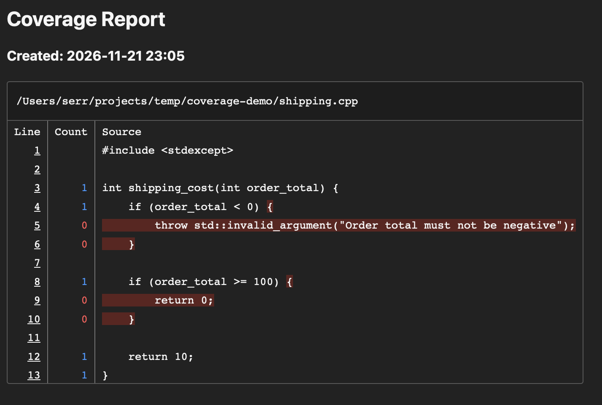

> команды приведены для macOS с установленными Command Line Tools:
> xcrun — часть окружения Apple

проверка наличия требуемого софта

```bash
xcrun clang++ --version
xcrun llvm-cov --version
xcrun llvm-profdata --version
```

беру программу с двумя условиями

```cpp
// shipping.cpp
#include <stdexcept>

int shipping_cost(int order_total) {
    if (order_total < 0) {
        throw std::invalid_argument("Order total must not be negative");
    }

    if (order_total >= 100) {
        return 0;
    }

    return 10;
}
```

правила простые:

- Отрицательная сумма — исключение.
- Сумма от 100 — бесплатная доставка.
- Сумма от 0 до 99 — доставка стоит 10.

простой тест, проверяющий только обычную платную доставку

```cpp
// test_shipping.cpp
#include <iostream>

int shipping_cost(int order_total);

int main() {
    if (shipping_cost(50) != 10) {
        std::cerr << "FAIL: expected shipping cost 10\n";
        return 1;
    }

    std::cout << "PASS\n";
    return 0;
}
```

далее необходимо собрать тест со счетчиками покрытия

```bash
xcrun clang++ -std=c++20 -O0 -g \
  -fprofile-instr-generate \
  -fcoverage-mapping \
  shipping.cpp test_shipping.cpp \
  -o test_shipping
```

здесь:

- `-O0` отключает оптимизацию.
- `-g` добавляет отладочную информацию.
- `-fprofile-instr-generate` добавляет счётчики выполнения.
- `-fcoverage-mapping` связывает счётчики с исходниками.

**Карта покрытия** — это таблица соответствий между участками
исходника и счётчиками выполнения. Её создаёт Clang при компиляции с
`-fcoverage-mapping` и помещает в исполняемый файл

вот что создалось

```
drwxr-xr-x 3 serr staff   96 ноя 21 22:53 test_shipping.dSYM
-rwxr-xr-x 1 serr staff 162K ноя 21 22:53 test_shipping
```

далее запускаю тест с сохранением профиля в файл

```bash
LLVM_PROFILE_FILE="test.profraw" ./test_shipping
```

получаю PASS и такой файл

```
-rw-r--r-- 1 serr staff  344 ноя 21 22:54 test.profraw
```

`test.profraw` — сырые счётчики выполнения

после запуска теста есть:

- `test_shipping` — исполняемый файл со счётчиками и картой покрытия.
- `test.profraw` — значения счётчиков, сохранённые при запуске.
- `shipping.cpp` — исходник, покрытие которого хотим увидеть.

далее подготавливаю данные так

```bash
xcrun llvm-profdata merge -sparse test.profraw -o coverage.profdata
```

- `llvm-profdata` - обрабатывает профили выполнения LLVM
- `merge` - объединяет профили и преобразует сырые данные в
  индексированный формат
- `-sparse` - делает профиль компактнее, исключая записи функций,
  которые ни разу не исполнялись
- `test.profraw` - входной сырой профиль запуска
- `-o coverage.profdata` - записывает результат в `coverage.profdata`

хотя входной файл один, используется команда `merge`: она нужна и для
преобразования формата. Если запусков несколько, можно объединить их:

```bash
xcrun llvm-profdata merge -sparse \
  first.profraw second.profraw \
  -o coverage.profdata
```

получится совокупное покрытие обоих запусков.

красивый отчет можно получить в html формате (результат будет в
указанной папке `coverage-html`, можно открыть `index.html` в
браузере)

```bash
xcrun llvm-cov show ./test_shipping \
  -instr-profile=coverage.profdata \
  -format=html \
  -output-dir=coverage-html \
  shipping.cpp
```

- `llvm-cov` - анализирует покрытие исходного кода
- `./test_shipping` - берет карту покрытия из собранного исполняемого
  файла
- `-instr-profile=coverage.profdata` - берет значения счетчиков из
  подготовленного профиля
- `shipping.cpp` - ограничивает отчет этим исходником

вот что получил я



| Показатель | Что говорит |
| --- | --- |
| **Function: 100%** | Функция хотя бы раз вызвана |
| **Line: 55,56%** | Исполнялись 5 из 9 учитываемых строк |
| **Region: 71,43%** | Исполнялись 5 из 7 участков кода |
| **Branch: 50%** | Исполнялись 2 из 4 исходов условий |

**главное действие — нажать на ссылку `shipping.cpp`**. Эта таблица
показывает, где есть пробелы, а страница исходника покажет, какие
именно строки и ветки не исполнялись



красная подсветка обозначает неисполненные участки

| Строка | Count | Что произошло |
| --- | ---: | --- |
| 3 | 1 | Функция вызвана один раз |
| 4 | 1 | Проверка `order_total < 0` выполнена |
| 5 | 0 | Исключение не выбрасывалось |
| 8 | 1 | Проверка `order_total >= 100` выполнена |
| 9 | 0 | Бесплатная доставка не возвращалась |
| 12 | 1 | Выполнен `return 10` |
